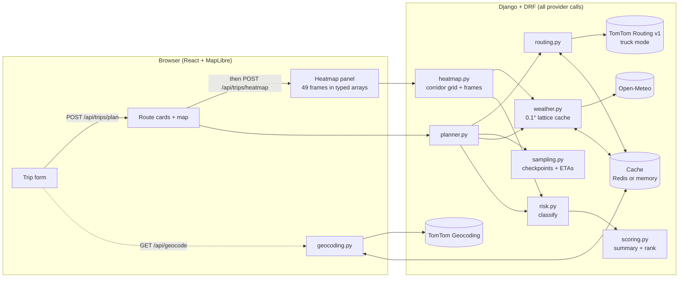

# Weather-Aware Truck Routing

A React + Django web app for truck drivers. Enter an origin, a destination, a departure time and a load weight. The app returns up to three truck routes, each scored for forecast weather risk along the way, and recommends one. Routes, checkpoints, risk levels and ETAs are shown on a map, and a 48-hour weather heatmap covers the trip corridor with an hour-by-hour slider.

Built for the Spotter Full Stack Developer assessment. The brief puts correctness and clarity ahead of extra features, and so does this build.

| | |
|---|---|
| **Hosted app** | _Not deployed yet_ |
| **Walkthrough (Loom)** | _Not recorded yet_ |
| **Stack** | Django 5.2 + DRF · React 19 + TypeScript + Vite · MapLibre GL JS · TanStack Query |
| **Providers** | TomTom Routing and Geocoding · Open-Meteo forecast · OpenFreeMap tiles (all free tiers, no card) |

---

## Contents

1. [What it does](#what-it-does)
2. [Quick start](#quick-start)
3. [Configuration](#configuration)
4. [Architecture](#architecture)
5. [API](#api)
6. [How routes are scored](#how-routes-are-scored)
7. [Heatmap](#heatmap)
8. [Free-tier budget and caching](#free-tier-budget-and-caching)
9. [When TomTom returns fewer than three routes](#when-tomtom-returns-fewer-than-three-routes)
10. [Assumptions](#assumptions)
11. [Measured performance](#measured-performance)
12. [Testing and quality](#testing-and-quality)
13. [Known limitations](#known-limitations)
14. [Attribution](#attribution)

---

## What it does

- **Trip form:**
  - Origin and destination autocomplete for any city worldwide (places outside the US show their country), minimum 3 characters, 300 ms debounce.
  - Departure date and time, sent with its UTC offset.
  - Load weight in lb.
  - Sampling interval of 10, 25 or 50 miles.
  - Inline validation.
- **Up to three truck routes** from TomTom (`travelMode=truck`, with the entered weight and departure time).
- **Checkpoints** every 10, 25 or 50 miles along each route, plus the destination. Each checkpoint has an ETA and the forecast weather at that ETA.
- **Risk per checkpoint:**
  - Low, Moderate, High, Severe or No Travel.
  - Based on wind, rain and snow, with load-based escalation for heavy trucks.
  - Names which condition drove the level.
- **Route summaries:** miles at each risk level, distance-weighted average risk, distance, duration, arrival time, and any forecast gaps.
- **A recommendation** with a one-sentence reason, for example "Recommended: fewest Severe miles (0.0 vs 42.0 on Route B), 18 min slower." If every route crosses a No Travel stretch, the least-bad route is marked as such and a blocking banner names the stretch.
- **Map:**
  - All routes coloured by segment risk; unselected routes are dimmed.
  - Checkpoint dots with a popup showing ETA, wind, gusts, rain, snow, level and driver.
  - Dashed grey segments where no forecast exists.
- **48-hour corridor heatmap:**
  - Layers: Risk, Wind, Rain or Snow.
  - A 0–48 h slider with the local date and time, play/pause, and a marker showing where each truck would be at the selected hour.
  - All 49 hourly frames arrive in one response, so the slider never touches the network.

Risk is computed **only on the backend**. The frontend maps levels to colours and labels; it never works out a level itself.

---

## Quick start

### Prerequisites

- [uv](https://docs.astral.sh/uv/) (installs Python 3.12 for you)
- Node.js 22.12 or newer
- A free [TomTom developer key](https://developer.tomtom.com/) (no card needed). Open-Meteo needs no key.

### Backend (Django API on :8000)

```bash
cd backend
uv sync                      # creates .venv with Python 3.12 and all dependencies
cp .env.example .env         # then set TOMTOM_API_KEY in .env
uv run python manage.py runserver
```

Check it: `curl localhost:8000/api/health` returns `{"status":"ok"}`.

### Frontend (Vite dev server on :5173)

```bash
cd frontend
npm install
npm run dev
```

Open <http://localhost:5173>. In development, Vite proxies `/api` to `localhost:8000`, so `VITE_API_BASE_URL` can stay empty.

### Checks

```bash
# backend/
uv run pytest                                        # all tests
uv run pytest trips/tests/test_risk.py::test_wind_boundaries   # a single test
uv run ruff check . && uv run ruff format --check .  # lint and format
uv run mypy .                                        # strict type-check

# frontend/
npm test                                             # Vitest
npx vitest run src/lib/heatmap.test.ts               # a single file
npm run lint && npm run typecheck && npm run build
```

GitHub Actions ([`.github/workflows/ci.yml`](.github/workflows/ci.yml)) runs all of these on every push and pull request.

### Provider smoke test (optional)

`uv run python scripts/provider_smoke.py .env smoke-results.json` (from `backend/`) makes about 10 TomTom requests and 4 Open-Meteo requests. It checks truck routing, alternatives, geocoding and the forecast format on your key. It never prints the key.

---

## Configuration

All settings come from environment variables. In development, `backend/.env` is loaded automatically; it is git-ignored.

| Variable | Where | Default | Purpose |
|---|---|---|---|
| `TOMTOM_API_KEY` | backend | — | Routing and geocoding. **Server-side only**; never sent to the browser. |
| `DJANGO_SECRET_KEY` | backend | dev key when `DJANGO_DEBUG=true` | Required when `DJANGO_DEBUG=false`. |
| `DJANGO_DEBUG` | backend | `false` | |
| `ALLOWED_HOSTS` | backend | `localhost,127.0.0.1` | Comma-separated. |
| `CORS_ALLOWED_ORIGINS` | backend | `http://localhost:5173` | The frontend's origin(s). `Retry-After` is exposed cross-origin. |
| `REDIS_URL` | backend | empty | Set to use Redis as the cache. Empty means an in-process memory cache (sized for 50,000 entries). |
| `WIND_SOURCE` | backend | `sustained` | `sustained` or `gust`: which wind value is scored. |
| `VITE_API_BASE_URL` | frontend | empty | API origin in production, e.g. `https://api.example.com`. |

The backend uses no database tables. Its only state is the cache.

---

## Architecture



**A plan request runs these steps in order:**
1. Validate the input.
2. Fetch the TomTom truck routes, then remove near-duplicates and top up to three if needed.
3. Sample checkpoints and ETAs.
4. Snap each checkpoint to a 0.1° weather cell and check the free-tier budget.
5. Look up the forecast hours each checkpoint needs, from cache or Open-Meteo.
6. Classify each checkpoint, then summarise and rank the routes.

The heatmap is a separate request, sent after the routes are on screen, so rendering the routes never waits for the heatmap.

### Backend layout (`backend/`)

| Module | Role |
|---|---|
| `trips/domain.py` | Dataclasses and the `RiskLevel` enum. **Pure.** |
| `trips/services/risk.py` | Threshold tables and `classify()`. **Pure.** |
| `trips/services/scoring.py` | Segments, miles by level, average risk, ranking, reason sentences. **Pure.** |
| `trips/services/sampling.py` | Polyline encode/decode, distances, checkpoints, ETAs. **Pure.** |
| `trips/services/geometry.py` | Route overlap, via points, proximity index. **Pure.** |
| `trips/services/routing.py` · `geocoding.py` · `weather.py` | `RoutingProvider` / `GeocodingProvider` / `WeatherProvider` interfaces, plus the TomTom and Open-Meteo clients and caching. |
| `trips/services/http.py` | One place for provider HTTP calls: 8 s timeout, one retry, error mapping. |
| `trips/services/planner.py` | Runs a plan from start to finish. |
| `trips/services/heatmap.py` | Corridor grid and the 49 hourly frames. |
| `trips/services/container.py` | Builds the real providers from settings. Tests swap in fakes. |
| `trips/api/` | Request validation (serializers), views, presenters, and the JSON contract as TypedDicts. |

The **pure** modules have no I/O and no Django imports. A test in `test_architecture.py` parses them and fails if that ever changes.

### Frontend layout (`frontend/src/`)

| Path | Role |
|---|---|
| `api/types.ts` · `api/client.ts` | The JSON contract (mirrors `trips/api/contracts.py`). A fetch wrapper turns the error format into an `ApiError` that says whether a retry makes sense. |
| `components/` | Trip form, route cards, checkpoint details, heatmap panel, legend. |
| `map/` | MapLibre view, route and segment GeoJSON, and `HeatmapController` (canvas source and truck markers). |
| `lib/risk.ts` | The one colour and label palette, used by lines, dots, bars, legend and heatmap. |
| `lib/heatmap.ts` | Typed-array frames, raster layout, frame painting, truck position at an hour. |

---

## API

Base path `/api`, JSON only.

| Method | Path | Purpose |
|---|---|---|
| `GET` | `/api/health` | Liveness check. |
| `GET` | `/api/geocode?q=Dallas` | Up to 5 suggestions worldwide: `{ "results": [{ "label", "lat", "lon" }] }`. |
| `POST` | `/api/trips/plan` | Routes, checkpoints, summaries, ranking and recommendation. |
| `POST` | `/api/trips/heatmap` | Corridor grid and 49 hourly frames of risk, wind, rain and snow. |

**Plan request**

```json
{
  "origin":      { "label": "Dallas, TX", "lat": 32.7767, "lon": -96.7970 },
  "destination": { "label": "Denver, CO", "lat": 39.7392, "lon": -104.9903 },
  "departure": "2026-11-25T06:00:00-06:00",
  "load_lb": 42000,
  "interval_mi": 25
}
```

**Plan response** (abridged)

```json
{
  "recommended_route_id": "r1",
  "no_safe_route": false,
  "corridor": { "bbox": [-105.6, 32.3, -96.2, 40.2], "max_grid_points": 200 },
  "routes": [{
    "id": "r1", "name": "Route A", "rank": 1,
    "reason": "Recommended: fewest Severe miles (0.0 vs 42.0 on Route B), 18 min slower.",
    "distance_mi": 882.4, "duration_s": 44100, "arrival": "2026-11-25T17:15:00-07:00",
    "geometry": "<encoded polyline, precision 5>",
    "summary": {
      "miles_by_level": { "low": 810.0, "moderate": 72.4, "high": 0.0, "severe": 0.0, "no_travel": 0.0 },
      "unknown_mi": 0.0, "avg_risk": 0.08, "unknown_checkpoints": 0, "no_travel_stretches": []
    },
    "segments": [{ "start_mi": 0, "end_mi": 25, "geometry": "...", "level": "low" }],
    "checkpoints": [{
      "index": 0, "lat": 32.7767, "lon": -96.797, "mile": 0, "eta": "2026-11-25T12:00:00Z",
      "wind_mph": 18.2, "gust_mph": 27.0, "rain_in_hr": 0.0, "snow_in_hr": 0.0,
      "level": "low", "driver": "wind"
    }]
  }]
}
```

**Heatmap request:**

```json
{ "bbox": [...], "route_geometries": ["..."], "start": "<departure ISO>", "load_lb": 42000, "max_points": 200 }
```

Send `max_points` as the plan's `corridor.max_grid_points`.

**Heatmap response:**

```json
{ "grid": { "lats": [...], "lons": [...], "spacing_deg": 0.4 }, "hours": 49, "risk": [[...]], "wind": [[...]], "rain": [[...]], "snow": [[...]] }
```

- `risk`, `wind`, `rain` and `snow` each hold one array per hour, with values in grid order.
- `risk` holds levels 0–4, or `null` where there is no forecast.

### Errors

Every error, including Django's own 400/403/404/500 pages, has the same shape: `{ "error": { "code": "...", "message": "..." } }`.

| Status | Code | When |
|---|---|---|
| 400 | `validation_error` | Bad input. The message names the field, e.g. `departure: Must include a UTC offset…`. |
| 422 | `no_route` | TomTom has no truck route between the places. |
| 422 | `budget_exceeded` | The trip needs more weather locations than the free-tier budget allows. The message suggests a larger interval. |
| 502 | `provider_unavailable` | A provider timed out (8 s, after one retry) or sent an unusable response. |
| 503 | `provider_rate_limited` | A provider returned HTTP 429. Comes with a `Retry-After` header and a "retry in N seconds" message. |

### Input rules

| Field | Rule |
|---|---|
| Origin, destination | Valid finite coordinates (anywhere in the world) and must differ. |
| Departure | ISO 8601 **with a UTC offset**; no more than 5 minutes in the past; at most 7 days ahead. |
| Load | Whole number of pounds, 1 to 80,000. |
| Interval | 10, 25 or 50 miles (default 25). |

---

## How routes are scored

### 1. Checkpoints and ETAs

- Checkpoints sit at 0, d, 2d, … along the route geometry, plus the destination. The last interval checkpoint is dropped if it falls within 0.25·d of the destination.
- Miles are scaled so the route total matches TomTom's reported distance.
- **ETAs follow TomTom's own timing.** The request asks for `extendedRouteRepresentation=travelTime`, which gives cumulative travel time at points along the route. That is interpolated to every point and then to each checkpoint.
- If those times are missing, ETAs are spread evenly by distance.
- ETAs never go backwards.

### 2. Weather at each ETA

- Each checkpoint's weather lookup is snapped to a **0.1° lattice cell**, so overlapping routes share lookups. The dot on the map keeps the true position.
- Open-Meteo hourly values used: `wind_speed_10m`, `wind_gusts_10m`, `rain`, `showers`, `snowfall`, in mph and inches, UTC.
- **Wind** uses the hour **nearest** the ETA; half past rounds up.
- **Rain and snow** use the **first full hour at or after** the ETA. Open-Meteo stamps each value at the end of the hour it covers.
- Rain rate is `rain + showers`; snow rate is `snowfall`.
- If any scored value is missing, the checkpoint is **`unknown`**. It is never treated as Low.

### 3. Risk classification

Intervals include their lower bound, so there are no gaps between bands. Rain's and snow's Severe bands also include their upper bound.

| Condition | Low | Moderate | High | Severe | No Travel |
|---|---|---|---|---|---|
| Wind (mph) | < 25 | [25, 35) | [35, 45) | [45, 55) | ≥ 55 |
| Rain (in/hr) | < 0.10 | [0.10, 0.25) | [0.25, 0.50) | [0.50, 1.00] | > 1.00 |
| Snow (in/hr) | < 0.5 | [0.5, 1.0) | [1.0, 2.0) | [2.0, 3.0] | > 3.0 |

**Load rules** apply to the wind level. "Greater than" is strict: exactly 30,000 lb and exactly 40,000 lb do not escalate.

| Wind | Load | Result |
|---|---|---|
| ≥ 55 mph | any | No Travel |
| [45, 55) mph | > 30,000 lb | No Travel (otherwise Severe) |
| [35, 45) mph | > 40,000 lb | Severe (otherwise High) |

- Checkpoint risk is the **highest** of wind (after load rules), rain and snow.
- The response names the `driver`. On a tie, the driver is picked in the order wind, rain, snow.
- All thresholds live in one data table in `risk.py`. `classify(wind_mph, rain_in_hr, snow_in_hr, load_lb)` only walks that table.
- Inputs are rounded to 6 decimal places before comparing. Otherwise floating-point noise (`0.01 + 0.09` is stored as `0.09999999999999999`) could move a value across a boundary.

### 4. Route summary

- **Segments:** each segment runs between two consecutive checkpoints and takes the **higher** of their two levels.
- **Miles by level:** the sum of segment lengths at each level.
- **Average risk:** the distance-weighted mean of segment levels (0–4), to 2 decimals.
- **Forecast gaps:** a segment touching an `unknown` checkpoint is unknown. Its miles are reported as `unknown_mi` and left out of `miles_by_level` and the average. A route with no known miles has `avg_risk: null`.

### 5. Recommendation

Routes are sorted by the key below, and the first is recommended. Miles are rounded to 0.1 before comparing, so floating-point noise can't decide a tie.

1. No Travel miles
2. Severe miles
3. High miles
4. Average risk (a route with no forecast at all sorts after an equal route that has one)
5. Travel time

- Full ties keep TomTom's order.
- The winner's reason compares it with the runner-up; every other route's reason compares it with the winner.
- If the recommended route still has No Travel miles, `no_safe_route` is true, the route is labelled **"Least bad"**, and `no_travel_stretches` gives the affected mile ranges for the banner.

---

## Heatmap

- **Corridor grid:**
  - A regular lattice around all routes, out to about 30 miles either side.
  - Spacing starts at 0.3° and widens in 0.1° steps until the grid fits its point budget (at most 200).
  - Grid points sit on the same 0.1° lattice as the checkpoints, so they share cached forecasts.
- **Frames:**
  - Frame *h* is `departure + h hours`, for h = 0…48.
  - Each frame uses the same hour alignment, the same `classify()` and the entered load as the checkpoints.
  - The wind layer shows the scored wind (gusts when `WIND_SOURCE=gust`).
- **Rendering:**
  - The 49 frames are stored as typed arrays (`Int8Array` for risk, `Float32Array` for the raw values).
  - Each frame is painted into a small canvas, one pixel per lattice cell, with rows spaced evenly in Web Mercator so they line up with the map.
  - MapLibre's linear resampling smooths it on screen.
  - The canvas source is created once. Moving the slider repaints the canvas and moves the truck markers with `setData`; no map source is re-created and no request is made. A test checks that dragging the slider makes no network call.
- **Layers:**
  - Risk uses the shared palette.
  - Wind, rain and snow use continuous colour scales that deliberately don't match the risk thresholds, so the frontend never implies a level it didn't receive.

---

## Free-tier budget and caching

Open-Meteo's free tier is 600 calls per minute, 5,000 per hour and 10,000 per day, counted per IP. It is the tightest limit. How multi-location requests are counted isn't documented, so this build assumes every location counts as one call.

| Rule | Value |
|---|---|
| Unique weather locations per trip (checkpoints + heatmap) | **≤ 500** |
| Checkpoint lattice cells | ≤ 400. Over that, the request gets `422 budget_exceeded` and the message suggests a larger interval. |
| Heatmap grid points | `min(200, 500 − checkpoint cells)`, returned as `corridor.max_grid_points`. The grid spacing widens to fit. |
| Coordinates per Open-Meteo request | ≤ 100, batches sent in parallel |
| Hours per request | Only the window needed (departure to arrival, or the 49 heatmap hours) |
| Variables | 5 |

| Cache | Key | TTL |
|---|---|---|
| Weather | 0.1° cell + UTC forecast hour | 60 min |
| Routes | origin, destination, departure hour, load (and via point) | 30 min |
| Geocoding | normalised query | 24 h |

Missing forecast values are never cached, so they are retried on the next plan.

TomTom allows 20,000 free requests a month for routing and the same again for geocoding. A plan uses 1 routing request, or up to 5 when the fallback below runs.

---

## When TomTom returns fewer than three routes

TomTom doesn't guarantee alternatives. In testing, Dallas → Denver returned 2 truck routes while Chicago → Atlanta returned 3.

1. **Duplicates are removed.** A route sharing more than 80% of its length with a kept route (within 0.5 mi) is dropped.
2. **Via points.** If fewer than 3 routes remain, routes are requested through points left and right of the primary route's midpoint, perpendicular to the trip direction, at **10%** of trip length. Both requests run in parallel.
3. **Wider second round.** If the 10% detours just rejoin the main road (measured at 80–81% overlap on Dallas → Denver), one more round runs at **20%**.
4. **Filters:**
   - Via points that land at sea or behind a closed border simply return no route, which is ignored.
   - Detours taking more than 1.5× the primary's travel time are dropped.
   - Failed via requests are ignored, so the plan still succeeds.
5. **Still short:** the routes found are returned, and the UI shows "Only N distinct routes available."

The spec's first step, retrying with relaxed `minDeviationDistance`/`minDeviationTime`, is **intentionally skipped**. TomTom accepts those parameters only when rebuilding a route you supply, through a POST request. Tested on Dallas → Denver, that returned the same 2 routes and added 5.2 s.

---

## Assumptions

The brief leaves these open. Each is a single, documented decision that's easy to change.

| Assumption | Choice | Where to change |
|---|---|---|
| Sampling interval | Chosen by the user (10 / 25 / 50 mi), not derived from trip length | `sampling.py` |
| Wind for scoring | Sustained wind (`wind_speed_10m`). Gusts are shown but not scored. | `WIND_SOURCE=gust` |
| Ranking | No Travel miles rank ahead of Severe miles (the brief's list starts at Severe) | `scoring.py` |
| Slider origin | Hour 0 is the **departure** time, not "now" | `heatmap.py` |
| Load weight | The entered weight is the weight the load rules refer to | — |
| Segment risk | A segment takes the higher of its two endpoint levels (conservative) | `scoring.py` |
| ETAs | Continuous driving, no hours-of-service rest breaks | `sampling.py` |
| Departure window | At most 7 days ahead, so every checkpoint ETA has a forecast | `serializers.py` |
| Coverage | Any city worldwide (the spec originally assumed US only; widened on request). Units stay imperial: miles, mph, inches and lb. | `geocoding.py` |
| Truck speed | TomTom's truck profile as returned (no extra speed cap) | `routing.py` |

---

## Measured performance

Measured on 2026-11-24 from a laptop against the live providers. "Cold" means nothing was cached.

| Scenario | Result |
|---|---|
| Chicago → Denver, 1,161 mi, **10 mi** interval, 3 routes, 370 checkpoints | **5.2 s** cold (target < 5 s: narrowly missed, almost entirely TomTom routing); **0.26 s** warm |
| Dallas → Denver, 882 mi, 25 mi, via fallback needed to reach 3 routes | 10.0 s cold |
| Heatmap for Chicago → Denver (125 points at 0.7°, 49 frames) | 0.64 s cold, 90 KB |
| Heatmap for Dallas → Denver (151 points at 0.4°) | 0.85 s cold, 0.17 s warm, 106 KB |
| Geocoding | about 0.2–0.7 s |
| Slider at 60 fps | **Not measured yet.** Each slider move repaints a canvas of a few thousand pixels and makes no network request. |

On a typical first request, TomTom truck routing takes 3.5–8 s and Open-Meteo about 0.5 s.

---

## Testing and quality

- **Backend:** 308 pytest tests, run offline. An autouse fixture fails any test that would make a real provider request. Coverage includes:
  - every threshold boundary in the risk table (wind 24.9/25 … 55; rain 0.09 … 1.00/1.01; snow 0.49 … 3.0/3.01);
  - the 30,000/30,001 and 40,000/40,001 lb load boundaries;
  - the driver field and ties;
  - mileage totals and weighted averages;
  - one fixture per ranking tiebreak;
  - forecast-hour alignment;
  - batching and caching;
  - provider timeouts and 429s;
  - the shared weather budget;
  - the via-point fallback;
  - one end-to-end API test per edge case in `trips/tests/test_scenarios.py`.
- **Frontend:** 51 Vitest + Testing Library tests: form validation, route cards, error and empty states, map wiring, heatmap frame painting, and the slider changing frames without a request.
- **Static checks:** ruff (lint and format), mypy in strict mode with django-stubs, ESLint, and `tsc` in strict mode.
- **Contracts:** the JSON shapes are defined twice, as TypedDicts in `backend/trips/api/contracts.py` and as TypeScript types in `frontend/src/api/types.ts`. Change both together.

---

## Known limitations

- **Plan latency.** TomTom truck routing alone takes 3.5–8 s on a first request, so the 5 s target holds only for cached repeats. The via fallback adds about 2–3 s per round.
- **Truck restrictions** are whatever TomTom's truck mode applies for the given weight. Height, hazmat and axle limits are not entered.
- **Worldwide, but imperial and US-tuned.** Any city can be planned, but distances, speeds and rates stay in miles, mph, inches and lb, and the risk thresholds come from the brief rather than local regulations. TomTom's truck coverage and data quality vary by country, and routes that cross the antimeridian (e.g. within Alaska's Aleutians or across the Pacific) are not handled.
- **Open-Meteo's free API is for non-commercial use.** An assessment demo with no ads or subscriptions fits that reading. A commercial version would need their paid API.
- **Free hosts share outbound IPs**, so Open-Meteo's per-IP limits may be hit by other tenants. That comes back as a 503 with a retry hint.
- **Payload size.** A 1,000+ mile plan response is about 370 KB, because full route geometry is sent for both routes and segments. The heatmap request sends the route geometries back to the server. Simplifying the geometry would shrink both.
- **The heatmap budget is trusted from the client.** The server is stateless, so `max_points` is validated (1–200) but not tied to a specific plan.
- **Forecasts change.** Results are a snapshot of forecasts that are at most 60 minutes old.

---

## Attribution

- Map data © [OpenStreetMap contributors](https://www.openstreetmap.org/copyright)
- Basemap tiles by [OpenFreeMap](https://openfreemap.org)
- Routing and geocoding © [TomTom](https://www.tomtom.com)
- [Weather data by Open-Meteo.com](https://open-meteo.com) (CC BY 4.0)
- Map rendering by [MapLibre GL JS](https://maplibre.org)

These credits are also shown in the map footer at all times.
